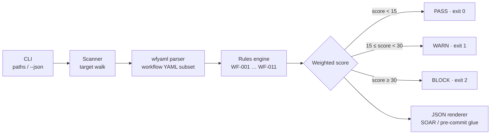

# 🛡️ wfshield — GitHub Actions workflow security auditor

[](https://www.python.org)
[](#)
[](#tests)
[](LICENSE)

**wfshield audits your `.github/workflows/*.yml` files for the CI supply-chain patterns behind the real-world attacks — unpinned third-party actions, `write-all` tokens, `pull_request_target` + fork checkouts, shell interpolation of untrusted GitHub context, secrets expanded at script level, self-hosted runners on fork events, remote pipe-to-shell installers and cache poisoning.**

One command, zero dependencies, and exit codes that gate it in CI: **fail the pull request before the pipeline becomes the attack surface.** The March-2025 `tj-actions/changed-files` compromise (a moved tag leaked every CI secret in affected repos within hours) and the October-2026 LiteLLM gateway attack started inside exactly these files. wfshield is the pre-flight check.

```bash
pip install wfshield   # or: pipx, or just vendor the single package
wfshield .github/workflows
```

```
  [CRITICAL] WF-005  line 23  job 'test' checks out fork code under pull_request_target
  [HIGH    ] WF-001  line 39  unpinned third-party action 'some-random-org/cool-action@main'
  [HIGH    ] WF-003  line 11  top-level permissions: write-all
  ...
  score 125  →  BLOCK   (1 CRITICAL, 5 HIGH, 3 MEDIUM, 3 LOW)
```

---

## Why this exists

GitHub Actions workflows are executable code with credentials attached. The attacks of the last two years share the same small set of root causes:

| Incident | Root cause | wfshield rule |
|---|---|---|
| tj-actions/changed-files (Mar 2025) | action pinned to a movable **tag**, tag force-pushed by attacker | WF-001 / WF-002 |
| Secret exfil via injected build logs | `pull_request_target` checked out **fork code** and ran it | WF-005 |
| Bad commits "fixing" CI | **`github.event.*` interpolated straight into `run:`** scripts | WF-006 |
| Leaked CI secrets | `${{ secrets.* }}` expanded at **script level** | WF-007 |
| Repo takeover after CI ran on fork PR | **`runs-on: self-hosted`** on untrusted triggers | WF-008 |
| Arbitrary one-liner installs | **`curl … | bash`** in workflows | WF-009 |

Every recommendation in OpenSSF Scorecards' pinning checks, GitHub's own hardening guide and SLSA's CI guidance maps to a wfshield rule — but wfshield needs nothing but Python to run, so it drops into any lint job, pre-commit hook or corporate locked-down runner.

Existing tools in the space (`zizmor`, `actionlint`, `gosec`-style linters) are excellent but Rust/Go/Node binaries you must install; wfshield is the **zero-dependency, pure-stdlib** option for the Python-based pipelines and restricted environments where those installs are the bottleneck.

## Installation

**From PyPI (once published):**

```bash
pip install wfshield
```

**From source (this repo):**

```bash
git clone https://github.com/mehulpatel23b-pixel/wfshield.git
cd wfshield
pip install .        # installs the wfshield console entrypoint
```

**Without installing at all** — it's pure stdlib, so:

```bash
python3 -m wfshield .github/workflows    # from the repo root on PYTHONPATH
```

Requirements: **Python 3.9+.** No third-party packages, no network calls, no git history access — wfshield only reads the files you point it at.

## Usage

```bash
wfshield .github/workflows                    # audit a directory
wfshield ci deploy.yml                        # audit specific files
wfshield .github/workflows --json             # SOAR / pre-commit / log ingestion
wfshield . --json > wfshield-report.json       # repo-wide, machine-readable
```

**Exit codes are the CI gate:**

| Code | Meaning | Trigger |
|---|---|---|
| `0` | PASS — no weighted findings | score < 15 |
| `1` | WARN — worth reviewing | 15 ≤ score < 30 |
| `2` | BLOCK — real supply-chain risk | score ≥ 30 |
| `64` | Error — unreadable/invalid input | missing files, unparseable YAML |

**In CI — fail the PR that weakens the pipeline:**

```yaml
# .github/workflows/audit.yml
name: wfshield
on: [push, pull_request]
permissions:
  contents: read
jobs:
  audit:
    runs-on: ubuntu-latest
    steps:
      - uses: actions/checkout@11bd71901bbe5b1630ceea73d27597364c9af683 # v4.2.2
      - uses: actions/setup-python@a26af69be951a213d495a42532970f4c890f3638 # v5.6.0
        with:
          python-version: '3.12'
      - run: pipx install wfshield
      - run: wfshield .github/workflows
```

**In pre-commit (local, before you even push):**

```bash
# .pre-commit-config.yaml
- repo: local
  hooks:
    - id: wfshield
      name: wfshield workflow audit
      language: system
      entry: wfshield
      files: ^\.github/workflows/.*\.ya?ml$
      pass_filenames: true
```

## What wfshield checks

| Rule | Severity | Weight | What it means | How to fix |
|---|---|---|---|---|
| WF-001 | HIGH | 15 | Third-party action (or docker image, or reusable workflow call) referenced by a **mutable tag/branch** — a pushed or hijacked ref executes in your pipeline | Pin to the full 40-char commit SHA |
| WF-001 | MEDIUM | 7 | `docker://` image referenced by mutable tag | Pin by digest `@sha256:…` |
| WF-002 | LOW | 3 | Official `actions/*`/`github/*` action on a mutable tag (tag moves are the tj-actions pattern even for big vendors) | Pin to SHA; verify against release tag when upgrading |
| WF-003 | HIGH | 15 | `permissions: write-all` — every job gets a read/write `GITHUB_TOKEN` | Start at `contents: read`, widen per job |
| WF-004 | MEDIUM | 7 | No explicit top-level `permissions:` — the workflow inherits repo defaults, which may be read/write without anyone noticing | Add an explicit least-privilege block |
| WF-005 | CRITICAL | 20 | `pull_request_target` + checkout of the **fork's head SHA** (= attacker's code) + repo secrets in scope | Move untrusted CI to `pull_request`; keep `pull_request_target` only for trusted-base workflows with gated secrets |
| WF-006 | HIGH | 15 | Untrusted GitHub context (`github.event.*`, `head_ref`, `ref_name`, `ref`, dispatch `inputs`) interpolated **directly inside a `run:` script** — shell injection → arbitrary code execution | Pass values via `env:` mapping; use `"$VAR"` in the script |
| WF-007 | HIGH | 15 | `${{ secrets.* }}` expanded at **script level** — the secret lands in `ps` output, env dumps and step logs on any echo/error path | Map secrets via `env:`, reference `"$SECRET_NAME"` |
| WF-008 | HIGH | 15 | **`self-hosted` runner** executing on `pull_request`/`pull_request_target` — forks run arbitrary code on your hardware | Ephemeral hosted runners for fork events, or approval + path filters |
| WF-009 | MEDIUM | 7 | **`curl/wget … \| bash`** remote script execution in `run:` | Download, verify a pinned checksum, then execute (or vendor the script) |
| WF-010 | LOW | 3 | `secrets: inherit` on a reusable workflow call forwards **every** repo secret | Pass only what the called workflow needs |
| WF-011 | MEDIUM | 7 | `actions/cache` reachable from `pull_request` — fork-triggered cache entries can poison later builds if restore keys are broad | Immutable keys (`github.sha`, content hashes), careful `restore-keys` |

Inherently safe contexts (`github.sha`, `github.event_name`, `matrix.*`, `env.*`, `runner.*`) are deliberately **not** flagged — the goal is signal, not noise. Secrets passed correctly via `env:` mappings and trusted refs like `refs/heads/main` raise no findings.

## Sample output

Text (default):

```
$ wfshield .github/workflows

wfshield — GitHub Actions workflow security audit

──[ vulnerable.yml ]────────────────────────────────────────────────
  [CRITICAL] WF-005  line 23  job 'test' checks out fork code under pull_request_target
      · '${{ github.event.pull_request.head.sha }}' checks out the untrusted PR's own commit, and the
        workflow then runs with full write secrets because pull_request_target never runs a fork's permissions.
      ✓ fix: Use pull_request for untrusted CI, or keep pull_request_target but check out the trusted base
        and explicitly gate secret use.

  [HIGH    ] WF-001  line 39  unpinned third-party action 'some-random-org/cool-action@main'
      · 'some-random-org/cool-action@main' references a mutable branch. If that ref is force-pushed,
        renamed, or compromised, the replacement code runs inside your workflow with your GITHUB_TOKEN
        and your secrets.
      ✓ fix: Pin to the full 40-character commit SHA: owner/repo@<full 40-char commit SHA>.

  ...
  score 125  →  BLOCK   (1 CRITICAL, 5 HIGH, 3 MEDIUM, 3 LOW)
```

JSON (`--json`):

```json
{
  "total_score": 125,
  "overall_verdict": "BLOCK",
  "exit_code": 2,
  "errors": [],
  "files": [
    {
      "file": "vulnerable.yml",
      "score": 125,
      "verdict": "BLOCK",
      "exit_code": 2,
      "counts": {"CRITICAL": 1, "HIGH": 5, "MEDIUM": 3, "LOW": 3},
      "findings": [
        {
          "rule": "WF-005",
          "severity": "CRITICAL",
          "line": 23,
          "title": "job 'test' checks out fork code under pull_request_target",
          "detail": "'${{ github.event.pull_request.head.sha }}' checks out the untrusted ...",
          "fix": "Use pull_request for untrusted CI, or keep pull_request_target but ..."
        }
      ]
    }
  ]
}
```

## Architecture



```
wfshield
└── src/wfshield/
    ├── wfyaml.py     dependency-free workflow-YAML parser (subset into Loc-str
    │                 scalars that remember their source line for finding output)
    ├── rules.py      11 findings, one per real-world failure class; weights & thresholds
    ├── scanner.py    path/target walk, per-file + aggregate scoring
    └── cli.py        text + JSON renderers, exit-code mapping
```

`wfyaml` never shells out to PyYAML or anything else. Where a `run: |` block or an inline `#` comment would break naive parsers, `wfyaml` handles literal/folded block scalars of every chomping flavor, quote-aware comment stripping, matrix-style sequences of mappings, and inline list syntax. All findings carry the **exact source line**, both in text output and JSON.

## Project structure

```
wfshield/
├── src/wfshield/
│   ├── __init__.py      version + public surface
│   ├── __main__.py      python -m wfshield
│   ├── wfyaml.py        YAML-subset parser, no dependencies
│   ├── rules.py         the 11 supply-chain rules + scoring
│   ├── scanner.py       target discovery + per-file results
│   └── cli.py           argparse, text/JSON output, exit codes
├── tests/
│   ├── test_wfyaml.py   17 parser tests
│   ├── test_rules.py    34 rule/scoring tests (incl. both example files)
│   └── test_cli.py      17 CLI/scanner tests (exit codes, JSON shape)
├── examples/
│   ├── vulnerable.yml   deliberately dangerous workflow — every rule fires (score 125 → BLOCK)
│   └── hardened.yml     reference hardened workflow — score 0 → PASS
├── pyproject.toml       PEP 621 packaging, console entrypoint
├── requirements.txt    nothing — generated for manager expectations
├── .gitignore           standard Python ignores
└── LICENSE              MIT
```

## Real-world use cases

1. **CI gate for pipeline changes** — add `wfshield .github/workflows` to lint jobs: a PR that adds an unpinned third-party action or widens the token **fails the build** the moment it's opened, not the day it's exploited.
2. **post-mortem regression** — after an incident (or a public one like tj-actions that made you check your own repos), run wfshield org-wide and fix the specific rule classes that were the root cause; re-run in CI to keep them fixed.
3. **Repository onboarding / M&A audit** — new repo into your org: one repo-wide command instantly shows whether the workflows follow your hardening baseline (pinning, least-privilege tokens, no fork+secrets overlap).
4. **pre-commit hard stop** — developers see WF-006/WF-007 findings **locally** before they ever push the risky workflow, with the exact one-line fix appended.
5. **Security managers + dashboards** — `--json` output feeds severity counts and malicious-pattern definitions straight into SOAR/scripts/audit databases; timestamp a daily or weekly scheduled run and track score-over-time.
6. **Generating hardened templates** — `examples/vulnerable.yml` and `examples/hardened.yml` are an enforceable pair: template the hardened one, and use wfshield to keep drifted copies honest.
7. **Agent-ops pipelines** — if AI agents write your workflows, audit every generated diff: LLM-authored YAML frequently interpolates `github.event.*` directly into `run:` blocks and pins actions to `@main` because docs on the web do. wfshield catches both before merge.

## Honesty section

- wfshield is a **static heuristic audit**, not a proof of security — a workflow with score 0 can still be abused (a PHISHED committer, a malicious pinned commit, or rules outside its scope).
- `wfyaml` parses the workflow YAML subset (nested maps, block seqs, block/folded scalars, inline lists, comments). Exotic YAML (anchors, multi-doc, nested flow style) is handled best-effort; unparseable files surface as **errors** (exit 64), never silently skipped.
- The **pinning checks are semantic, not cryptographic**: wfshield can't prove a SHA is the one the maintainer signed — pair with Sigstore/attestations if your threat model demands it.
- Severity weighting (WF-005=20 … WF-010=3) is an opinionated default mirroring public incident data; tune your own thresholds from the JSON if your org wants stricter or looser gates.
- Trusted-context decisions (e.g., whitelisting `github.sha`, `matrix.*`, env-indirection) reflect current GitHub guidance, but guidance evolves — pin your wfshield version in CI.

## Tests

60+ unit tests (68 at time of writing) cover both example workflows end-to-end:

```bash
python3 -m unittest discover -s tests
# Ran 68 tests in 0.09s OK
```

The suite asserts: parser behavior on quoted keys, matrix lists, block scalars, inline comments, garbage indentation, lineno provenance; every rule fires on its target pattern and **stays silent** on the safe equivalents (the false-positive ledger); text/JSON output shapes and all four exit codes.

## Related projects & further reading

- [actions/cache cache-poisoning writeup](https://adnan.dev/how-a-supply-chain-attack-via-cache-poisoning-works) — the vector behind WF-011
- [GitHub's security hardening guide](https://docs.github.com/en/actions/security-for-github-actions/security-guides/security-hardening-for-github-actions) — WF-006/WF-007 mitigations
- [OpenSSF Scorecards pinning check](https://github.com/ossf/scorecard) — WF-001/WF-002 rationale
- [zizmor](https://github.com/woodruffw/zizmor) and [actionlint](https://github.com/rhysd/actionlint) — heavier alternative auditors (great if you can install Rust/Go binaries)

## License

MIT — see [LICENSE](LICENSE).
